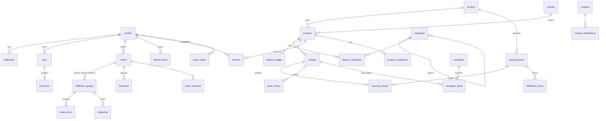
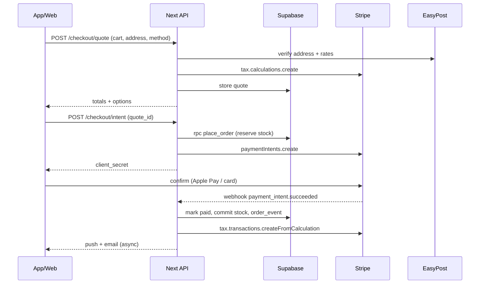

# Ashan Market — Architecture

_Status: **draft for approval** · 2026-10-27_

Decisions so far: Supabase backend. Fulfillment model undecided, so the design uses per-location inventory and seeds one warehouse. The project lives in a session folder for now.

## 1. Stack

| Layer            | Choice                                                                                                                                         | Notes / changes vs. brief                                                                                                                                                                                                                                                                                                                                                                           |
| ---------------- | ---------------------------------------------------------------------------------------------------------------------------------------------- | --------------------------------------------------------------------------------------------------------------------------------------------------------------------------------------------------------------------------------------------------------------------------------------------------------------------------------------------------------------------------------------------------- |
| Monorepo         | **Turborepo + pnpm workspaces**                                                                                                                | as proposed                                                                                                                                                                                                                                                                                                                                                                                         |
| Runtime          | Node 24 LTS                                                                                                                                    | installed at `~/.local/node`                                                                                                                                                                                                                                                                                                                                                                        |
| Mobile           | **Expo SDK (latest) + Expo Router**, TypeScript, EAS Build → iOS                                                                               | Android comes almost free later                                                                                                                                                                                                                                                                                                                                                                     |
| Web              | **Next.js (App Router)** + Tailwind CSS                                                                                                        | storefront **and** `/admin` in the same app (route group, role-gated) instead of a separate admin app: fewer deploys at MVP                                                                                                                                                                                                                                                                         |
| Mobile styling   | **Token theme hook** (`useTheme()` over `@ashan/tokens`) + StyleSheet. NativeWind is deferred                                                  | **Updated in M1:** web uses Tailwind v4, while stable NativeWind (4.x) still targets Tailwind v3, and NativeWind 5 is only a release candidate. Both platforms read the same token source (`packages/tokens`): web through generated CSS variables, mobile through the hook. Revisit NativeWind 5 when it's stable. Components stay platform-specific (`packages/ui-web`, `apps/mobile/components`) |
| Data fetching    | **TanStack Query** on both platforms                                                                                                           | shared query hooks in `packages/api`                                                                                                                                                                                                                                                                                                                                                                |
| Forms/validation | **zod** + react-hook-form                                                                                                                      | schemas shared by client, server and admin                                                                                                                                                                                                                                                                                                                                                          |
| Backend          | **Supabase**: Postgres, Auth, Storage, RLS, Edge Functions (Deno)                                                                              |                                                                                                                                                                                                                                                                                                                                                                                                     |
| Server logic     | Postgres functions (RPC) for transactional ops (reserve stock, place order). **Next.js Route Handlers** for Stripe/EasyPost calls and webhooks | Keeps secrets server-side; one TypeScript server codebase; Edge Functions only for scheduled jobs                                                                                                                                                                                                                                                                                                   |
| Payments         | Stripe PaymentIntents · Payment Element (web) · `@stripe/stripe-react-native` PaymentSheet (iOS, Apple Pay) · **Stripe Tax**                   | Phase 2: Stripe Connect (Express accounts, separate charges & transfers)                                                                                                                                                                                                                                                                                                                            |
| Shipping         | **EasyPost**: address verification, rates, labels, tracking webhooks                                                                           | Shippo equivalent; EasyPost has better address verification                                                                                                                                                                                                                                                                                                                                         |
| Search           | Postgres FTS (`tsvector`) + `pg_trgm` + `unaccent` + synonyms table                                                                            | `search_products` RPC behind an interface so Meilisearch can replace it                                                                                                                                                                                                                                                                                                                             |
| i18n             | `i18next` + `react-i18next` (shared catalogs in `packages/i18n`)                                                                               | `en`, `ne`; ICU plurals; Devanagari font (Mukta / Noto Sans Devanagari)                                                                                                                                                                                                                                                                                                                             |
| Email            | **Resend** + React Email templates                                                                                                             |                                                                                                                                                                                                                                                                                                                                                                                                     |
| Push             | Expo Push (expo-server-sdk)                                                                                                                    |                                                                                                                                                                                                                                                                                                                                                                                                     |
| Observability    | Sentry (web + mobile), Supabase logs                                                                                                           |                                                                                                                                                                                                                                                                                                                                                                                                     |
| Testing          | Vitest (packages, server), React Testing Library, **Playwright** (web E2E), Jest + RNTL (mobile), **pgTAP** (RLS/RPC tests)                    |                                                                                                                                                                                                                                                                                                                                                                                                     |
| Hosting          | Vercel (web), Supabase Cloud, EAS (iOS)                                                                                                        |                                                                                                                                                                                                                                                                                                                                                                                                     |

## 2. Folder structure

```
ashan-market/
├─ apps/
│  ├─ web/                    # Next.js: storefront + /admin
│  │  ├─ app/
│  │  │  ├─ [locale]/(shop)/          # home, c/[slug], p/[slug], search, cart, checkout, account/*
│  │  │  ├─ [locale]/(admin)/admin/   # products, inventory, orders, coupons, banners, users, analytics
│  │  │  ├─ [locale]/(legal)/         # privacy, terms, shipping, returns, compliance
│  │  │  └─ api/                      # route handlers: checkout, stripe/webhook, easypost/webhook, account/delete
│  │  └─ components/
│  └─ mobile/                 # Expo Router
│     ├─ app/(tabs)/          # home, categories, search, cart, account
│     ├─ app/product/[slug].tsx, app/checkout/*, app/orders/*
│     └─ components/
├─ packages/
│  ├─ tokens/                 # design tokens (TS source) → CSS vars, Tailwind preset, RN theme
│  ├─ ui-web/                 # web components (Radix primitives + Tailwind)
│  ├─ i18n/                   # en.json, ne.json, helpers (formatMoney, formatWeight)
│  ├─ schemas/                # zod schemas + inferred types (Product, Cart, Address, …)
│  ├─ db/                     # generated Supabase types (supabase gen types)
│  ├─ api/                    # typed client: Supabase queries/RPCs + TanStack Query hooks
│  ├─ core/                   # pure domain logic: pricing, coupons, cart eligibility, shipping rules (heavily unit-tested)
│  └─ config/                 # eslint, tsconfig (strict), tailwind base, vitest base
├─ supabase/
│  ├─ migrations/             # SQL migrations (schema, RLS, functions)
│  ├─ seed.sql                # ~40 Nepali products, categories, synonyms, one warehouse
│  ├─ functions/              # edge functions: scheduled jobs (flash-sale state, abandoned cart)
│  └─ tests/                  # pgTAP
├─ docs/                      # research.md, architecture.md, compliance.md, brand.md
├─ .env.example
└─ turbo.json, pnpm-workspace.yaml
```

## 3. Data model

Conventions: `uuid` PKs, `created_at/updated_at`, money as **integer cents** + `currency char(3)` (always `USD` at launch), weights in **grams** (display oz/lb + g). Bilingual text uses `*_en` / `*_ne` columns on catalog tables. Only two languages are planned, and columns are simpler to query and index than a translations table.



### Core tables (abridged)

**Identity**

- `profiles(id → auth.users, full_name, phone, locale, home_zip, marketing_opt_in, role enum[customer, staff, admin], deleted_at)`
- `addresses(id, user_id, name, line1, line2, city, state, zip, country='US', phone, is_default, verified_at, easypost_id)`
- `push_tokens(id, user_id, expo_token, platform, last_seen_at)`

**Vendors (Phase-2 ready)**

- `vendors(id, slug, name, status, stripe_account_id null, commission_bps default 0, is_house bool)`. Seeded with one house vendor, "Ashan Market".
- `vendor_members(vendor_id, user_id, role)`

**Catalog**

- `categories(id, parent_id, slug, name_en, name_ne, icon, sort, is_active)`
- `brands(id, slug, name_en, name_ne, logo_path)`
- `products(id, vendor_id, brand_id, slug, name_en, name_ne, description_en, description_ne, tags text[], dietary text[], spice_level smallint, status enum[draft, active, archived], search_vector tsvector generated)`
- `product_images(id, product_id, storage_path, alt_en, alt_ne, sort)`
- `variants(id, product_id, sku unique, title_en, title_ne, option_values jsonb {size:"500 g"}, price_cents, compare_at_cents, net_weight_g, shipping_weight_g, shipping_class enum[ambient, chilled, frozen], requires_age_check bool, barcode, is_active)`
- `product_compliance(product_id, country_of_origin, ingredients_en, ingredients_ne, allergens text[] /* FDA major 9 */, may_contain text[], net_qty_label, nutrition_facts_path, manufacturer_name, manufacturer_address, fda_facility_reg_no, importer_of_record, english_label_verified bool, label_image_path, reviewed_by, reviewed_at)`. Fields are detailed in `docs/compliance.md` (catalog milestone).
- `price_history(variant_id, price_cents, effective_from)` → powers honest compare-at / "lowest in 30 days".

**Inventory & fulfillment**

- `stock_locations(id, vendor_id, name, kind enum[warehouse, hub, pickup_point], address…, metro enum[nyc, dfw, bay_area, dmv, null], timezone, pickup_enabled, local_delivery_enabled)`
- `inventory_levels(variant_id, location_id, on_hand, reserved, reorder_point, PRIMARY KEY(variant_id, location_id))`
- `inventory_lots(id, variant_id, location_id, lot_code, best_before, qty, received_at)` (expiry tracking, FEFO picking, recall support)
- `fulfillment_zones(id, location_id, method enum[local_delivery, pickup], zip_codes text[], fee_cents, min_order_cents, slots jsonb)`

**Merchandising**

- `campaigns(id, kind enum[flash, festival, weekly, collection], slug, title_en, title_ne, banner_path, starts_at, ends_at, metro null, coupon_id null)`
- `campaign_items(campaign_id, variant_id, sale_price_cents null, qty_cap null, sort)`
- `banners(id, placement, image_path, link, title_en, title_ne, starts_at, ends_at, sort)`
- `coupons(id, code, kind enum[percent, fixed, free_shipping], value, min_subtotal_cents, max_discount_cents, starts_at, ends_at, usage_limit, per_user_limit, first_order_only)`
- `coupon_redemptions(coupon_id, user_id, order_id)`

**Search**

- `search_synonyms(id, terms text[])`, for example `{achar, achaar, aachar, अचार}` and `{chau chau, chauchau, wai wai, waiwai, noodles, चाउचाउ}`. Admin-editable.
- Index: GIN on `products.search_vector` (weighted A=name, B=brand/tags, C=description, both languages) + GIN trigram on `name_en`.

**Shopping**

- `carts(id, user_id null, anon_id null, zip, coupon_id)`; `cart_items(cart_id, variant_id, qty)`. Guest carts are keyed by an anon id and merged on sign-in.
- `wishlist_items(user_id, product_id)`; `recently_viewed` on device (local), synced for signed-in users.
- `reviews(id, product_id, user_id, order_item_id, rating 1–5, title, body, photos text[], status enum[pending, published, rejected])`

**Orders**

- `orders(id, number 'AM-100123', user_id, email, status enum[pending_payment, paid, partially_fulfilled, fulfilled, cancelled, refunded], subtotal_cents, discount_cents, shipping_cents, tax_cents, total_cents, coupon_id, shipping_address jsonb (snapshot), locale, stripe_payment_intent_id, stripe_tax_calculation_id)`
- `fulfillment_groups(id, order_id, vendor_id, location_id, method enum[ship, local_delivery, pickup], status, service_level, rate_cents, slot_start, slot_end, easypost_shipment_id, tracking_code, tracking_url, label_path)`. **This is where Phase 2 sub-orders live**: one group per vendor × method, so a marketplace order splits naturally.
- `order_items(id, fulfillment_group_id, variant_id, product_snapshot jsonb, qty, unit_price_cents, discount_cents, tax_cents)`
- `payments(id, order_id, provider='stripe', intent_id, status, amount_cents, refunded_cents)`
- `return_requests(id, order_id, items jsonb, reason, photos, status, refund_cents)`
- `order_events(id, order_id, type, data jsonb, created_at)`: the timeline for tracking UI and audit.

**Phase 2 (tables designed now, created later):** `vendor_payouts`, `vendor_applications`, `commission_ledger(fulfillment_group_id, gross, commission, net, transfer_id)`.

### Row Level Security (summary)

- Catalog tables: public `SELECT` where `status='active'`; write only `role in (staff, admin)`. In Phase 2, vendor members can write their own `vendor_id` rows.
- `profiles`, `addresses`, `carts`, `wishlist_items`, `push_tokens`: owner-only.
- `orders`/`order_items`/`fulfillment_groups`: owner `SELECT`. Inserts only through the `place_order` RPC / server role. Staff can see all.
- `inventory_levels.reserved` is mutated only by `SECURITY DEFINER` functions.
- pgTAP tests assert each policy (milestone gate).

## 4. API design

The client talks to Supabase directly for reads (RLS-guarded) and to Next.js route handlers for anything involving secrets or money.

### Reads (Supabase client, typed, in `packages/api`)

| Hook                          | Source                                                                                                                       |
| ----------------------------- | ---------------------------------------------------------------------------------------------------------------------------- |
| `useHome(zip)`                | RPC `home_feed(zip, locale)` → banners, active campaigns, flash sale, categories, popular_in_area                            |
| `useCategoryTree()`           | `categories`                                                                                                                 |
| `useProducts(filters)`        | RPC `search_products(q, category, brand, price_min, price_max, in_stock, dietary, sort, page, zip)` → items + facets + total |
| `useProduct(slug, zip)`       | RPC `product_detail(slug, zip)` → product, variants, availability per method, ETA, compliance, rating summary, related       |
| `useCart()`                   | `carts`/`cart_items` + RPC `cart_evaluate(cart_id, zip)` (pricing, coupon, eligibility per line, free-ship progress)         |
| `useOrders()`, `useOrder(id)` | `orders` + `order_events`                                                                                                    |

### Mutations / server routes (`apps/web/app/api`, all zod-validated, auth via Supabase JWT)

| Route                          | Purpose                                                                                                                                                     |
| ------------------------------ | ----------------------------------------------------------------------------------------------------------------------------------------------------------- |
| `POST /api/address/verify`     | EasyPost verification → normalized suggestion                                                                                                               |
| `POST /api/checkout/quote`     | Cart + address/method → shipping rates (EasyPost) / local fees, Stripe Tax calculation, totals. Returns `quote_id` (stored, 15 min TTL)                     |
| `POST /api/checkout/intent`    | `quote_id` → RPC `place_order` (reserves stock, status `pending_payment`) → Stripe PaymentIntent (with `tax_calculation` hook) → `client_secret`            |
| `POST /api/stripe/webhook`     | `payment_intent.succeeded` → mark paid, commit stock, create Stripe Tax transaction, enqueue emails/push; `payment_failed`/`canceled` → release reservation |
| `POST /api/orders/:id/cancel`  | Allowed before fulfillment → refund + release                                                                                                               |
| `POST /api/orders/:id/return`  | Creates `return_request`                                                                                                                                    |
| `POST /api/orders/:id/reorder` | Adds available variants to cart, reports unavailable ones                                                                                                   |
| `POST /api/easypost/webhook`   | Tracker updates → `order_events` + push                                                                                                                     |
| `POST /api/push/register`      | Saves Expo token                                                                                                                                            |
| `DELETE /api/account`          | App Store–required deletion: revoke Apple token, anonymize orders (kept for tax records), delete PII, delete auth user                                      |
| `/api/admin/*`                 | Label purchase, refunds, bulk inventory import (CSV) — staff only                                                                                           |

Stock reservation: `place_order` locks `inventory_levels` rows (`SELECT … FOR UPDATE`), checks `on_hand - reserved >= qty`, increments `reserved`. A scheduled job releases reservations for intents unpaid after 30 min.

## 5. Key flows (sequence)



## 6. Fulfillment rules (`packages/core`)

- A variant with `shipping_class != ambient` is eligible only for `local_delivery` / `pickup` from a location whose zone covers the ZIP.
- The cart is split into fulfillment groups by (vendor, location, method). At MVP, usually one group.
- Free-shipping threshold (config, e.g. $49) applies to the `ship` group, Standard service only.
- Express ships only from the warehouse; local delivery offers slots from `fulfillment_zones.slots`.

## 7. Design tokens & brand

`packages/tokens/src/*.ts` is the single source → build script emits `tokens.css` (CSS variables, light/dark), `tailwind-preset.ts` (web + NativeWind) and `theme.ts` for RN.

Proposed original palette (to be finalized in brand milestone, AA-checked):

- **Sindoor crimson** `#B3261E` (primary), **Himalayan slate** `#1F2A37` (text), **Marigold** `#E8A33D` (festival accent, Tihar), **Rhododendron** `#D9476B` (sale), **Prayer-flag blue/green** for status, warm **paper** background `#FBF7F2`.
- Motifs: a Dhaka-weave geometric pattern drawn as original SVG (used in thin borders and festival banners), and a minimal mountain-ridge line in the logo mark.
- Type: **Inter** (Latin) + **Mukta** (Devanagari), both OFL.

## 8. Cross-cutting

- **Auth (built in M2):** Supabase Auth with 6-digit email and SMS codes (one flow on web and iOS), Sign in with Apple (native ID token + nonce on iOS, OAuth on web) and Google (PKCE; system browser sheet on iOS). Browsing and cart work without an account. Web sessions live in HTTP-only cookies, refreshed by `proxy.ts`; iOS sessions live in the Keychain via a chunked `expo-secure-store` adapter.
  - **Profiles:** created by an `auth.users` trigger. RLS limits customers to their own row, and column grants stop them changing `role`.
  - **Account deletion:** in-app on both platforms via the `delete_my_account()` RPC (App Store 5.1.1(v)).
  - **Open before App Store submission (M9):** Apple requires revoking Sign in with Apple tokens when an account is deleted. Plan: on delete, the iOS app re-requests an Apple authorization code, and a server route exchanges it at Apple's `/auth/token` and calls `/auth/revoke` (needs the Apple key, so it is built once the developer account exists).
- **i18n:** locale in URL on web (`/en`, `/ne`) for SEO; device locale + setting on mobile. Money/dates via `Intl` (`en-US`, `ne-NP` numerals optional).
- **Accessibility:** WCAG 2.2 AA target, with axe checks in Playwright, RN accessibility labels, dynamic type and 44pt targets.
- **Security:** secrets only in server env; Stripe webhook signature verification; RLS everywhere; rate limit on auth/checkout routes.
- **Analytics (admin):** SQL views over orders (GMV, AOV, top products, by metro); later PostHog.

## 9. Milestones (each: tests + summary + commit)

1. Monorepo scaffold (tokens, config, CI script, empty apps running)
2. Auth (+ account deletion stub, profiles, RLS)
3. Catalog + seed (~40 products, placeholder images) + `docs/compliance.md`
4. Search (FTS + synonyms + facets)
5. Cart → checkout (Stripe test mode, Stripe Tax, EasyPost test)
6. Orders (history, tracking, reorder, cancel/returns)
7. Admin dashboard
8. Push + email notifications
9. iOS build config (EAS, App Store metadata checklist)

## 10. Accounts you'll need (and when)

| Account                                                                   | Needed by                                       | Cost                       |
| ------------------------------------------------------------------------- | ----------------------------------------------- | -------------------------- |
| **Supabase** (one dev project)                                            | Milestone 1                                     | free tier                  |
| **Google Cloud** OAuth client                                             | Milestone 2                                     | free                       |
| **Apple Developer Program**                                               | Milestone 2 (Sign in with Apple), required by 9 | $99/yr                     |
| **Twilio** (phone OTP), optional, can defer                               | Milestone 2                                     | pay-as-you-go              |
| **Stripe** (test mode is enough until launch)                             | Milestone 5                                     | free                       |
| **EasyPost** (test API key)                                               | Milestone 5                                     | free test mode             |
| **Resend** + a domain you own (email + Apple Pay web domain verification) | Milestone 8 (domain helpful earlier)            | free tier / ~$12/yr domain |
| **Expo / EAS**                                                            | Milestone 8–9                                   | free tier                  |
| **Vercel**                                                                | when you want a public preview                  | free tier                  |

I won't create or invent keys. `.env.example` lists every variable, and you paste real values into `.env.local`.

## 11. Open questions for approval

1. **Local database:** Docker isn't installed, and the Supabase CLI needs it for a local Postgres. Options: (a) install OrbStack or Docker Desktop for a fully local stack (**recommended**: offline dev, pgTAP tests, and no risk to shared data), or (b) develop against a hosted Supabase dev project.
2. **Free-shipping threshold and flat rates:** placeholder $49 / Standard via EasyPost rates. OK?
3. **Admin inside the web app** (route group) rather than a separate app. OK?
4. **NativeWind + shared tokens** instead of fully shared UI components (react-native-web/Tamagui). OK?
5. **No cash on delivery; guest checkout allowed.** OK?
